<p>
<picture>
  <source media="(prefers-color-scheme: dark)" srcset="assets/banner-dark.svg">
  
</picture>
</p>

<p align="center">
  <a href="https://github.com/fornhere/super-ajan/actions/workflows/kontrol.yml"></a>
  
  
  
  <a href="LICENSE"></a>
  <a href="https://youtube.com/@fornyapayzeka"></a>
</p>

<p align="center"><b>Pencere pencere gezmeyi bırakın. Tek bir ajanla konuşun, gerisini o takip etsin.</b></p>

---

Farklı işleri farklı oturumda yapmak doğru. Ama oturum sayısı artınca kendinize yeni bir iş açıyorsunuz: **hangisi bitti, hangisi sizi bekliyor, hangisi takıldı?**

Süper ajan bu takibi sizden alır. Siz yalnızca onunla konuşursunuz. O her işi kendi projesinde, ayrı bir Claude Code oturumunda başlatır, biten işi işi yapmamış başka bir ajana kontrol ettirir, eksik olanı geri gönderir, kararınız gereken yerde size tek cümleyle sorar ve testlerden geçen kod değişikliğini projeye ekletir. Takılan ya da kapanan oturumu da fark eder.

<p>
<picture>
  <source media="(prefers-color-scheme: dark)" srcset="assets/akis-dark.svg">
  
</picture>
</p>

## İlk kez mi deneyeceksiniz?

Kendi projenize dokunmadan 10 dakikada görün. Deneme seti, bilerek hatası ve eksik özelliği bırakılmış küçük bir proje kurar ve üç kartı hazırlar: bir hata düzeltmesi, size seçenek soran bir özellik ve ona bağlı bir içerik işi.

```bash
bash deneme/kur.sh ../kitaplik-denemesi
```

Ayrıntılar: [deneme/README.md](deneme/README.md)

## Üç adımda kurulum

**1. İndirin ve makinenizi kontrol edin**

```bash
git clone https://github.com/fornhere/super-ajan merkez
cd merkez
./kontrol.sh ~/projeniz
```

`kontrol.sh` hiçbir şeyi değiştirmez. Claude Code sürümünü, `--bg` ve `agents` desteğini, git ve Python'u, verdiğiniz projelerde güven onayını yoklar; eksik olanı tek satırla söyler.

**2. Projelerinize güven onayı verin**

İş vereceğiniz her proje klasöründe bir kez `claude` açıp güven onayını kabul edin. Onay yoksa arka plan oturumu başlamaz, süper ajan size bildirir.

**3. İşi anlatın, süper ajanı başlatın**

`merkez` içinde Claude Code açıp işi anlatın: `/is-karti yapılacak iş`. Komut işi inceler, belirsiz yeri size sorar ve bir iş kartı yazar. Kartı okuyup `Durum: hazir` yapın. Sonra:

```bash
claude --agent super-ajan --name super-ajan --permission-mode auto
```

ve süper ajana **"hazır kartları başlat"** yazın. Gerisi bu konuşmadan yürür.

## Ne için kullanılır

| Ne yapmak istiyorsunuz | Nereden başlayın |
|---|---|
| Sistemi güvenle denemek | [Deneme seti](deneme/README.md) |
| Bir projede birkaç hatayı aynı anda düzeltmek | [KULLANIM.md → 2](KULLANIM.md#2-tek-projede-birkaç-hata-düzeltmesi) |
| Farklı projelerde ilgisiz işleri birlikte yürütmek | [KULLANIM.md → 3](KULLANIM.md#3-farklı-projelerde-aynı-anda-ilgisiz-işler) |
| Önce araştırıp sonra karar verip uygulamak | [KULLANIM.md → 4](KULLANIM.md#4-araştırma--karar-özeti--uygulama) |
| Her birleştirmeyi kendiniz onaylamak | [KULLANIM.md → 5](KULLANIM.md#5-temkinli-mod-birleştirmeden-önce-sor) |
| Gece açık bırakıp sabah sonuçlara bakmak | [KULLANIM.md → 6](KULLANIM.md#6-bilgisayarı-açık-bırakıp-uzun-süre-çalıştırmak) |
| İyi bir iş kartı yazmak | [10 örnek kart ve rehber](ornek-kartlar/README.md) |

## Bir konuşma böyle görünür

Aşağıdaki satırlar temiz bir kurulumla yapılan gerçek bir provadan, değiştirilmeden alındı. İş, örnek bir projede boş e-postada çöken kayıt formunu düzeltmekti.

```text
❯ Bu projede birleştirmeden önce bana sor. Hazır kartları başlat.
● Hazır olan tek kartın (001-bos-eposta-cokmesi) işçi oturumunu başlattım.
  Bu projede birleştirmeden önce onayını isteyeceğim.
● Kart 001'in işçisi işini bitirdiğini bildirdi. Kartı incelemeye aldım ve inceleme oturumunu başlattım.
● Kart 001 incelemeden geçti. Kod kartı olduğu için doğrulamaya aldım ve doğrulama oturumunu başlattım.
● Kart 001 doğrulamadan geçti ve birleştirme provası temiz çıktı
  (dal worktree-kart-001-bos-eposta, 1 commit). Bu dalı ana dala birleştireyim mi?
❯ Evet, birleştir.
● Kart 001 bitti: worktree-kart-001-bos-eposta dalı ana dala e99b19e birleştirme commit'iyle girdi.
```

İşi siz yazmadınız, işçinin penceresini açmadınız, kontrolü siz yapmadınız. Karar gereken tek yerde size soruldu.

## Parçalar

Kural basit: **yargı gereken yerde ajan, gerekmeyen yerde program.** Programlar limit harcamaz.

| Parça | Tür | Ne yapar |
|---|---|---|
| **süper ajan** | ajan | Konuştuğunuz tek ajan. İşi dağıtır, takip eder, sizi yalnız karar gerekince, iş bitince ya da iş takılınca böler. Dosya yazma aracı yoktur. |
| **işçi** | ajan | Kartı kendi projesinde, kendi dalında yapar. Bitince, takılınca ya da karar gerekince süper ajana tek cümle yazar. |
| **incelemeci** | ajan | İşi yapmamış ayrı bir ajan. Kartın "bitti" şartına bakar, istenen gerçekten yapılmış mı kontrol eder. |
| **doğrulayıcı** | ajan | Kod işlerinde kartın kontrollerini çalıştırır, sonucu yumuşatmadan yazar. |
| **birleştirici** | ajan | Değişikliği ana dalın geçici bir kopyasında birleştirir, projenin kurallarını ve testlerini orada koşar. Geçerse ana dalı ileri sarar, geçmezse ana dala dokunmaz. Push yapmaz. |
| `pano.sh` | program | Bütün kartlar tek tabloda, altında özet. `./pano.sh --izle` canlı tablo. |
| `gozcu.sh` | program | On dakikada bir oturumlara bakar, kapanan ya da takılanı süper ajana söyler. |
| `birlestirme-hazirla.sh` | program | Ana dala dokunmadan çakışma var mı bakar. |

Yardımcılar: `/is-karti` kart yazdırır, `baslat.sh` oturum açar, `durum.sh` kart durumunu değiştirir, `kontrol.sh` kurulumu yoklar, `ayarlar.sh` modelleri seçer.

## Hangi rol hangi model

| Rol | Varsayılan | Nereden değişir |
|---|---|---|
| süper ajan | opus, high | `.claude/agents/super-ajan.md` → `model:`, `effort:` |
| işçi | sonnet, high | `ayarlar.sh`; tek bir iş için karta `Model: opus` |
| incelemeci | sonnet, high | `ayarlar.sh` |
| doğrulayıcı | sonnet, medium | `ayarlar.sh` |
| birleştirici | sonnet, high | `ayarlar.sh` |
| gözcü, pano, prova | model yok | — |

En kolayı profil seçmek: `ayarlar.sh` içinde `PROFIL=ekonomik`, `dengeli` (varsayılan) ya da `guclu`. Profiller öneridir, ölçülmedi. Seçimi oturum açmadan görmek için: `SUPER_AJAN_KURU=1 ./baslat.sh isler/<kart> isci`. Ayrıntı: [KULLANIM.md](KULLANIM.md#hangi-rol-hangi-model).

## Bu orkestrasyon değil

Orkestrasyon **tek bir işi** parçalara böler: "bana bir site yap" denir, alt ajanlar tasarımı, kodu ve testi yapar, sonuç tek bir sitedir.
Süper ajan işi parçalamaz, **birbirinden bağımsız işleri** takip eder: bir hata düzeltmesi, bir araştırma, başka bir projede yeni bir özellik. Her biri kendi klasöründe, kendi oturumunda yürür. İkisi birlikte de çalışır; bir oturum kendi işini alt ajanlara bölebilir, süper ajan yine yalnız sonucuyla ilgilenir.

## Kontrol sizde

- **Birleştirmeyi kendiniz yapmak** isterseniz süper ajana "birleştirmeden önce sor" deyin. Önemli projelerde bunu öneririz.
- Projenizin `AGENTS.md` ya da `CLAUDE.md` dosyasında birleştirme kuralı (tam test turu vb.) varsa birleştirici onu uygular, yoksa kartın kontrollerini çalıştırır.
- Geçemeyen iş aynı işçiye döner. Üç turda geçmezse karar size gelir.
- Arada bir, biten işlerden birini açıp kendiniz bakın. Süper ajan işleri yönetiyor, süper ajanı siz yönetiyorsunuz.

## Dikkat

- Her oturum limitinizden ayrı harcar. Tek iş için kurmayın.
- Oturumlar bilgisayar kapanınca durur.
- Bir bilgisayarda aynı anda tek süper ajan çalıştırın; işçiler `super-ajan` adına mesaj atar.
- Otomatik izin modu soruları azaltır. Oturumlar internetten okudukları metinden etkilenebilir; önemli işlerde ayrı bir işletim sistemi hesabı veya kapsayıcı kullanın.
- Süper ajanın dosya yazma aracı yok, ama kabuk komutu çalıştırabilir. Bu tam bir güvenlik sınırı değil, davranış kuralıdır.
- `.env` ve anahtar dosyaları işçilere yasaktır, ama bunu kural sağlar, kilit değil.
- Kod işlerinde arka plan oturumları projenizin içinde `.claude/worktrees/` klasörü açar. Bu klasörü projenizin `.gitignore` dosyasına ekleyin. İş bitince eski dalları ve worktree'leri `git worktree list` ile görüp kendiniz temizleyin.

## Gereksinimler ve platformlar

- Claude Code 2.1.293 veya sonrası; `claude --bg` ve `claude agents` (araştırma önizlemesi) çalışmalı.
- Hesabınızda otomatik izin modu (`--permission-mode auto`) açık olmalı.
- `git` 2.38 veya sonrası, `bash` ve Python 3.8 veya sonrası (`python3` ya da `python`).
- Kod işleri için projenin git deposu olması gerekir.

| Sistem | Durum |
|---|---|
| Linux | Gerçek işlerle uçtan uca denendi, betikler her güncellemede otomatik test ediliyor |
| macOS | Betikler her güncellemede otomatik test ediliyor (macOS'un kendi bash 3.2 sürümü dahil); gerçek oturumlarla henüz denenmedi |
| Windows | Komutları Git for Windows ile gelen Git Bash'te çalıştırın. Betikler her güncellemede otomatik test ediliyor; gerçek oturumlarla henüz denenmedi |

<details>
<summary><b>Sık sorulanlar</b></summary>

**Limitimi çok mu harcar?**
Her işçi, incelemeci ve doğrulayıcı ayrı bir oturumdur, yani tek oturumdan fazla harcar. Pano, gözcü ve birleştirme provası model kullanmaz. Aynı anda birkaç iş yürütmüyorsanız gerek yok.

**Yöneticiye ucuz model verebilir miyim?**
`.claude/agents/super-ajan.md` dosyasındaki `model:` satırını değiştirebilirsiniz. DeepSeek yöneticiye hafif modelin yettiğini söylüyor; bu kitte güçlü model seçildi, çünkü işi geri gönderme kararı süper ajanda.

**Zor bir işe güçlü model verebilir miyim?**
Evet. Karta `Model: opus` ve isterseniz `Efor: high` satırı ekleyin; yalnız o işin işçisi etkilenir.

**Kod dışı işler olur mu?**
Olur. Kartta `Tür: icerik` yazan işler (araştırma, metin, not) incelemeden geçince biter, birleştirme adımı yoktur.

**Bir oturum takılırsa ne olur?**
Gözcü on dakikada bir bakar. Kapanan ya da uzun süredir hareketsiz oturumu süper ajana bildirir, süper ajan da size tek cümleyle yazar.

**Süper ajan bilgisayarım kapalıyken çalışır mı?**
Hayır. Bilgisayarınız açıkken çalışır.

</details>

## Kaynak ve lisans

Fikir DeepSeek'in süper ajan yaklaşımından geliyor: [deepseek-ai/dsh-superagent-prototype](https://github.com/deepseek-ai/dsh-superagent-prototype). Bu kit onun kodu değildir; fikrin Claude Code'a uyarlanmış, farklı projelere yayılmış hâlidir.

[MIT lisansı](LICENSE) · [Sürüm notları](CHANGELOG.md) · [Forn AI, YouTube](https://youtube.com/@fornyapayzeka)

<details>
<summary><b>English summary</b></summary>

**Super-agent kit** lets you manage separate Claude Code sessions spread across different projects through a single "super agent". You talk only to the super agent. It starts each job in its own session inside the job's project, has finished work checked by a different agent, sends incomplete work back, asks you only when a decision is yours, and has code changes that pass the project's checks merged. It also notices sessions that stall or close. Experimental. The documentation above is in Turkish.

This kit is not DeepSeek's code. It is an adaptation of the idea in [deepseek-ai/dsh-superagent-prototype](https://github.com/deepseek-ai/dsh-superagent-prototype) to Claude Code.

**Requirements:** Claude Code 2.1.293+ with `claude --bg` and `claude agents` (research preview); auto permission mode on your account; `git` 2.38+, `bash`, Python 3.8+. Works in a Linux or macOS terminal (macOS's built-in bash 3.2 is enough); on Windows use Git Bash. Scripts are tested automatically on all three systems; end-to-end runs with real sessions have been done on Linux only.

**Use in three steps**
1. `git clone https://github.com/fornhere/super-ajan merkez`, then `./kontrol.sh ~/your-project` inside it. Open `claude` once in each project and accept the trust prompt.
2. In `merkez`, open Claude Code and write job cards with `/is-karti <the job>`. Read each card and set `Durum: hazir`.
3. Start the super agent and say "hazır kartları başlat" ("start the ready cards"):
   ```bash
   claude --agent super-ajan --name super-ajan --permission-mode auto
   ```

Say "birleştirmeden önce sor" ("ask before merging") if you want to merge yourself. Each session spends from your usage limit separately; use a separate OS account or container for important work.

</details>
